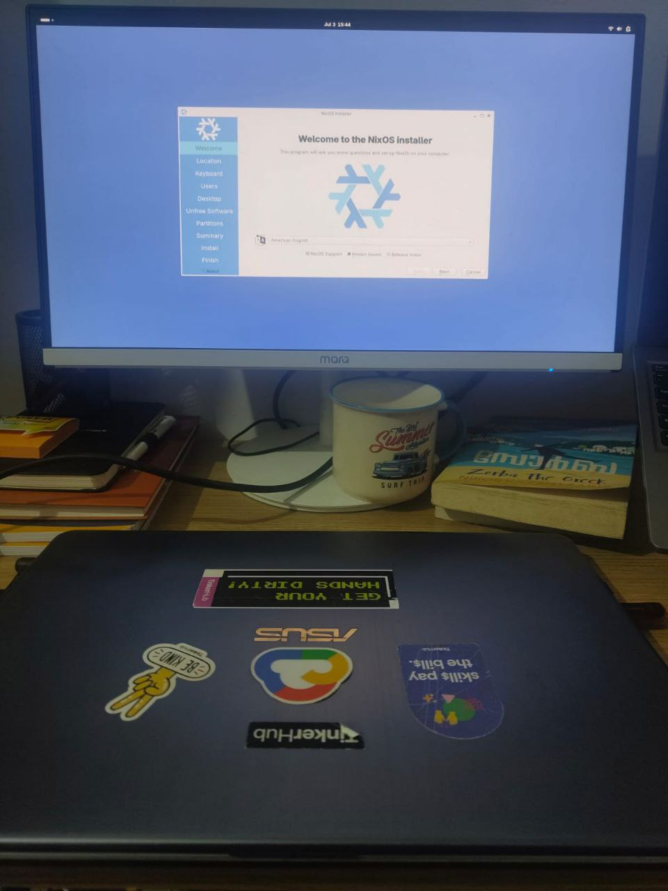

A self-hosted, NixOS-powered homelab running a lightweight Kubernetes
cluster via k3s, complete with monitoring and dashboards; all
declaratively managed and exposed via local DNS.

I’ve shared this setup within my close circle and hobby clubs. Figured
out it’s time to put it out here too.

neozorba@nixlab.local

Full setup here →
[neozorba-nixlab.local](https://github.com/AmalChandru/neozorba-nixlab.local)
